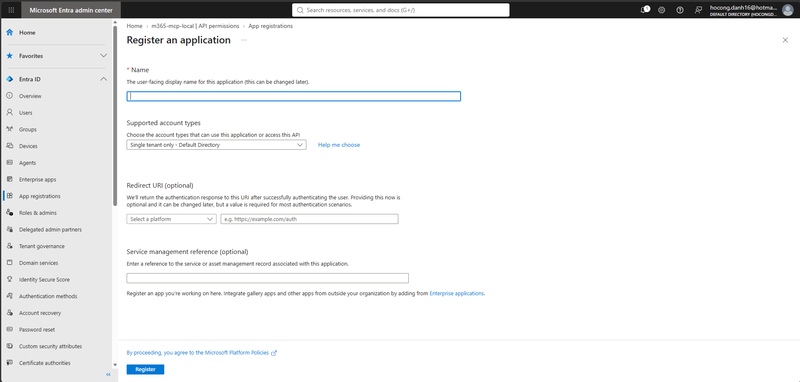
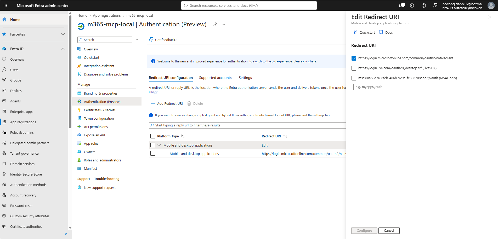
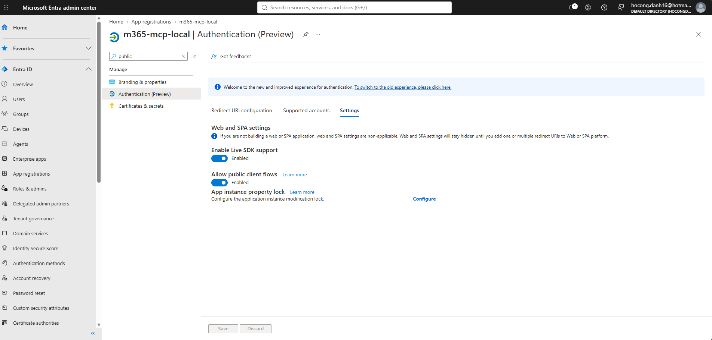
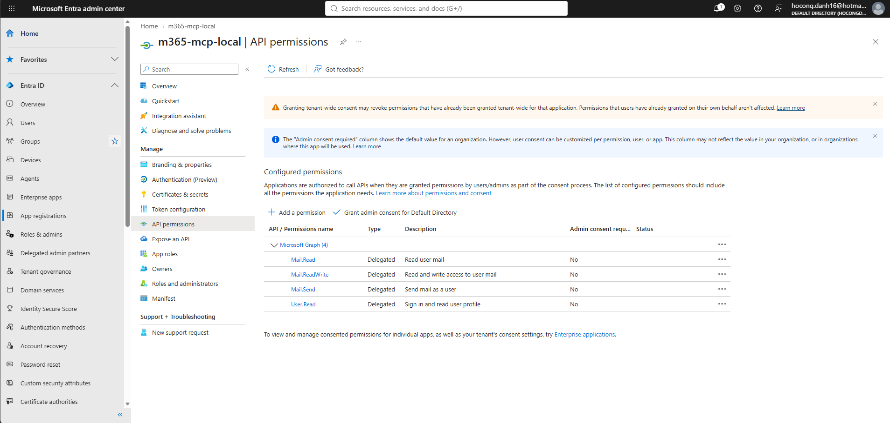
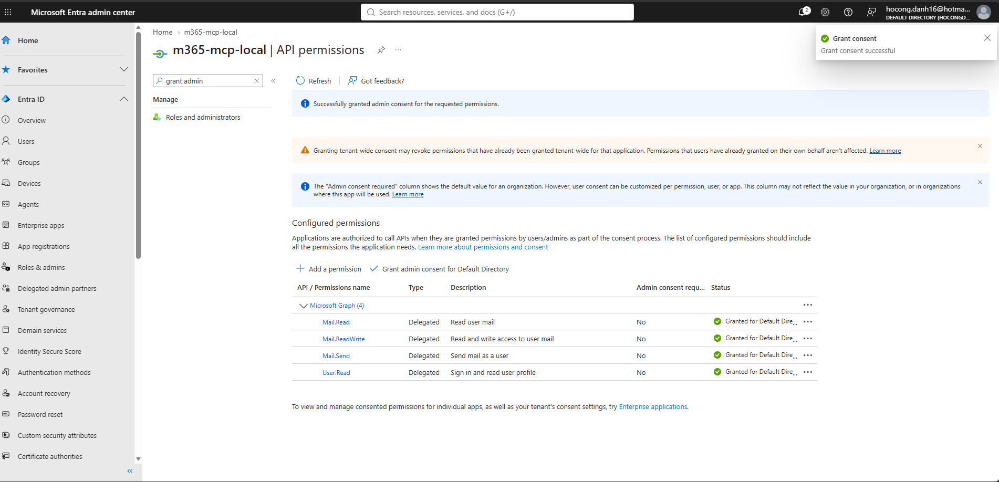
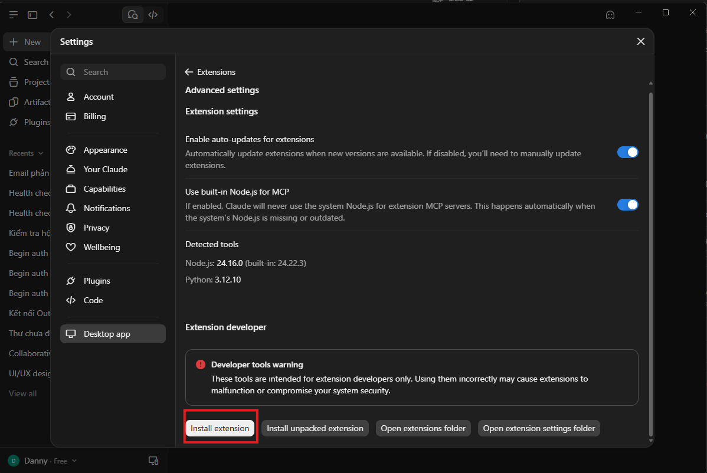
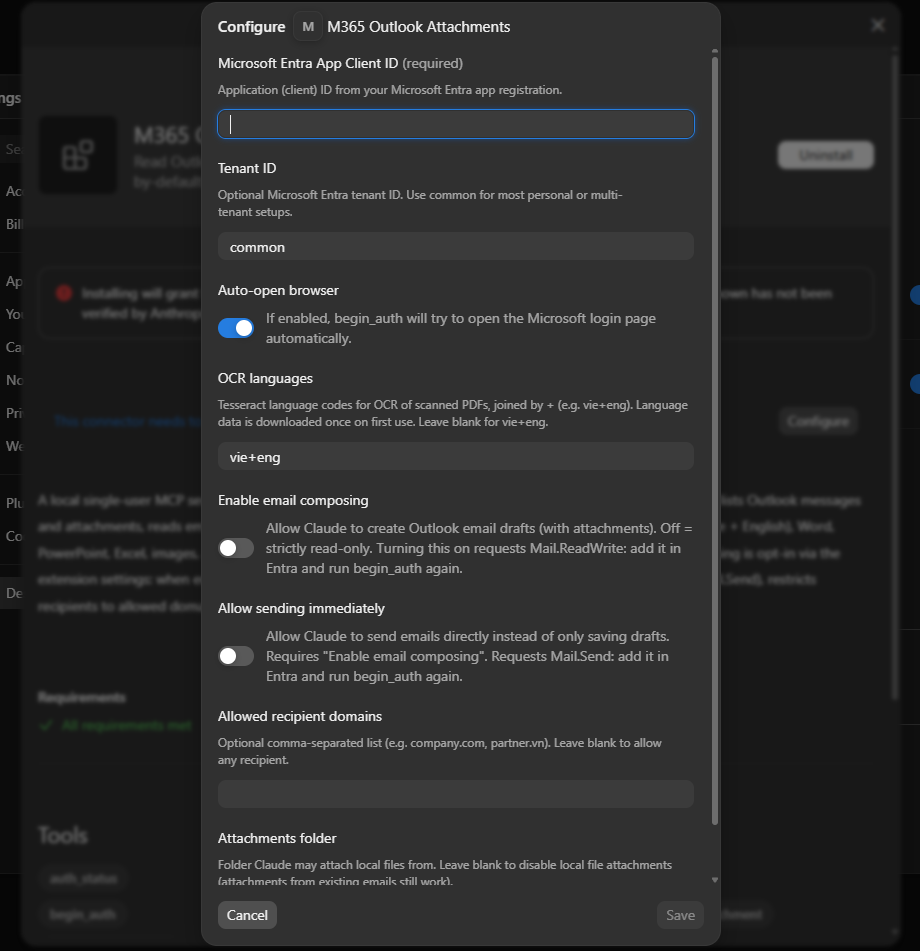

# Hướng dẫn cài đặt trợ lý Email Outlook cho Claude

Tài liệu này giúp bạn cài trợ lý đọc & gửi email Outlook ngay trong **Claude Desktop**.
Làm theo 3 phần, khoảng 10–15 phút. Không cần biết lập trình.

**Chuẩn bị:**
- Máy tính đã cài **Claude Desktop**.
- Một tài khoản **Microsoft 365 / Outlook**.
- File cài đặt `m365-outlook-mcp-<phiên bản>.mcpb` (người cấp cho bạn sẽ gửi kèm).

> Mặc định trợ lý **chỉ đọc email**. Việc soạn/gửi mail phải tự bật thêm (Phần 4), nên bạn dùng yên tâm.

---

## Phần 1 — Đăng ký ứng dụng trên Microsoft Entra

Bước này cho phép trợ lý kết nối vào hộp thư của bạn một cách an toàn. Chỉ làm **một lần**.
Kết quả cần lấy: một mã **Client ID** (và **Tenant ID**) để điền ở Phần 2.

### 1.1. Tạo ứng dụng mới

Vào <https://entra.microsoft.com> → menu trái **App registrations → New registration**.
Đặt một cái tên bất kỳ (ví dụ `m365-mcp-local`), để nguyên các mục còn lại → bấm **Register**.

*Gõ tên vào ô **Name**, rồi bấm **Register** ở cuối trang.*

### 1.2. Thêm nền tảng "Mobile and desktop"

Vào mục **Authentication → Add a platform → Mobile and desktop applications**.
Tích vào dòng kết thúc bằng `.../oauth2/nativeclient` → bấm **Configure**.

*Tích chọn dòng `nativeclient` như trong hình.*

### 1.3. Bật "Allow public client flows"

Vẫn trong **Authentication**, mở tab **Settings**, gạt **Allow public client flows** sang **Yes (Enabled)** → bấm **Save**.
Bước này bắt buộc để đăng nhập được.

*Gạt **Allow public client flows** sang **Enabled**.*

### 1.4. Cấp quyền đọc email

Vào **API permissions → Add a permission → Microsoft Graph → Delegated permissions**, thêm:
- **User.Read**
- **Mail.Read**

*(Nếu sau này muốn trợ lý soạn/gửi mail, thêm cả **Mail.ReadWrite** và **Mail.Send** — xem Phần 4.)*

*Danh sách quyền sau khi thêm.*

Sau đó bấm **Grant admin consent** và xác nhận. Cột **Status** của các quyền sẽ chuyển sang dấu **xanh "Granted"**.

*Sau khi bấm **Grant admin consent**, cột **Status** hiện dấu xanh.*

### 1.5. Lấy mã Client ID & Tenant ID

Vào mục **Overview**. Copy lại hai dòng:
- **Application (client) ID** → đây là **Client ID**.
- **Directory (tenant) ID** → đây là **Tenant ID** (nếu dùng tài khoản cá nhân, có thể để `common`).

Hai mã này nằm ở màn hình **Overview** của ứng dụng. Giữ kín, đừng chia sẻ.

> **Dành cho nhiều người dùng trong cùng công ty:** admin chỉ cần đăng ký **một ứng dụng Entra duy nhất** (Phần 1 này) rồi phát **cùng một Client ID + Tenant ID** cho mọi người. Mỗi người cài extension trên máy mình và **đăng nhập email Microsoft của riêng họ** ở Phần 3 — ai dùng hộp thư của người đó, hoàn toàn riêng biệt. Không cần tạo App ID riêng cho từng người. Dùng chung một App giúp admin quản lý và cấp/thu quyền tập trung ở một chỗ.

---

## Phần 2 — Cài đặt vào Claude Desktop

1. Mở **Claude Desktop → Settings (Cài đặt) → Extensions**.
2. Bấm **Install extension** và chọn file `.mcpb` *(hoặc kéo thả file vào cửa sổ Claude Desktop)*.

*Bấm nút **Install extension** (khoanh đỏ) rồi chọn file `.mcpb`.*

3. Sau khi cài xong, bấm **Configure** ở ứng dụng vừa cài và điền:

   | Ô cần điền | Điền gì |
   |---|---|
   | **Microsoft Entra App Client ID** | Dán **Client ID** lấy ở Phần 1 *(bắt buộc)* |
   | **Tenant ID** | Dán **Tenant ID**, hoặc để `common` |
   | **OCR languages** | Để `vie+eng` (đọc được tiếng Việt + Anh) |
   | **Enable email composing** | Để **tắt** (bật sau nếu cần gửi mail) |
   | **Allow sending immediately** | Để **tắt** |
   | **Allowed recipient domains** | Để trống |
   | **Attachments folder** | Để trống |

*Dán **Client ID** vào ô đầu tiên. Các công tắc gửi mail để tắt lúc này.*

4. Bấm **Save**.

---

## Phần 3 — Đăng nhập & dùng thử

Mở một cuộc trò chuyện mới trong Claude Desktop:

1. Nhắn: **"đăng nhập Microsoft giúp tôi"** → Claude sẽ mở trình duyệt và hiện một mã.
2. Đăng nhập tài khoản Microsoft, nhập mã, bấm đồng ý.
3. Xong! Thử các câu sau:
   - *"Liệt kê 10 email gần nhất của tôi"*
   - *"Đọc nội dung file đính kèm trong email mới nhất"*
   - *"Kiểm tra hộp thư xem có email lừa đảo hay quảng cáo không"*

---

## Phần 4 — Bật gửi mail (tùy chọn)

Chỉ làm nếu bạn muốn trợ lý **soạn, trả lời, chuyển tiếp hoặc gửi** email.

1. **Trên Entra** (quay lại Phần 1.4): thêm quyền **Mail.ReadWrite**; nếu muốn gửi thẳng không cần duyệt, thêm cả **Mail.Send**. Nhớ bấm **Grant admin consent** lại.
2. **Trong Claude Desktop → Configure:**
   - Bật **Enable email composing** → trợ lý **tạo được bản nháp** để bạn xem lại.
   - Bật thêm **Allow sending immediately** → cho phép **gửi thẳng**.
   - **Attachments folder:** chọn một thư mục **riêng** để chứa file cần đính kèm (ví dụ `D:\GuiMail`). Để trống thì không đính kèm được file trên máy. **Đừng chọn** thư mục Downloads hay Documents.
   - **Allowed recipient domains:** ví dụ gõ `tencongty.com` để chỉ gửi nội bộ. Để trống thì gửi được cho mọi người.
3. Bấm **Save**, rồi nhắn **"đăng nhập Microsoft lại giúp tôi"** để cấp quyền mới.

> **An toàn khi gửi:** mặc định trợ lý **chỉ tạo bản nháp** trong Outlook để bạn kiểm tra rồi tự bấm gửi. Muốn gửi ngay, bạn phải nói rõ ("gửi luôn…") và đã bật "Allow sending immediately".

---

## Trợ lý làm được gì

- **Đọc email & file đính kèm:** đọc nội dung mail, và cả file PDF, Word, Excel, PowerPoint, ảnh, file nén, kể cả **PDF scan tiếng Việt** (tự nhận chữ trong ảnh).
- **Cảnh báo email lừa đảo / quảng cáo:** kiểm tra link giả, người gửi giả mạo, file đính kèm nguy hiểm.
- **Soạn / trả lời / chuyển tiếp / gửi email** (khi bật ở Phần 4), có thể đính kèm file.

---

## Gặp sự cố?

| Hiện tượng | Cách xử lý |
|---|---|
| Trợ lý báo chưa đăng nhập | Nhắn "đăng nhập Microsoft giúp tôi" và làm theo bước Phần 3 |
| Báo lỗi không đủ quyền khi gửi mail | Chưa thêm quyền trên Entra — làm lại Phần 4 bước 1, rồi đăng nhập lại |
| Đã bật gửi mail nhưng vẫn không gửi được | Chưa **đăng nhập lại** sau khi bật; nhắn Claude đăng nhập Microsoft lần nữa |
| Báo "attachments disabled" | Chưa chọn **Attachments folder** trong phần Configure |
| PDF scan tiếng Việt đọc sai chữ | Lần đầu cần có mạng để tải dữ liệu tiếng Việt; thử lại sau vài giây |

> **Lưu ý:** trợ lý này chỉ chạy trong **Claude Desktop trên máy đã cài**. Không dùng được trên điện thoại hay claude.ai trên web.
